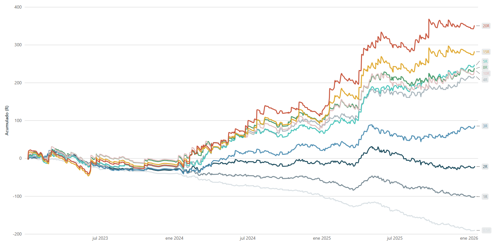
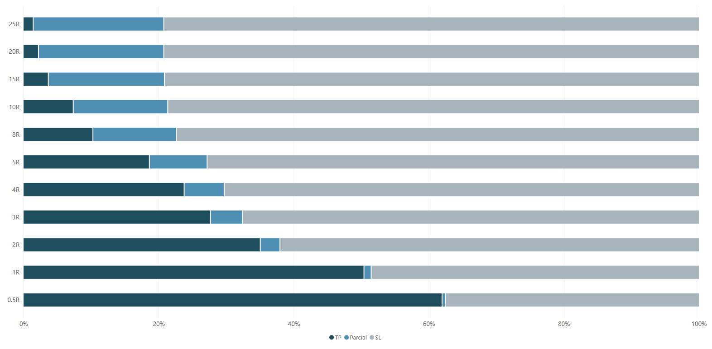
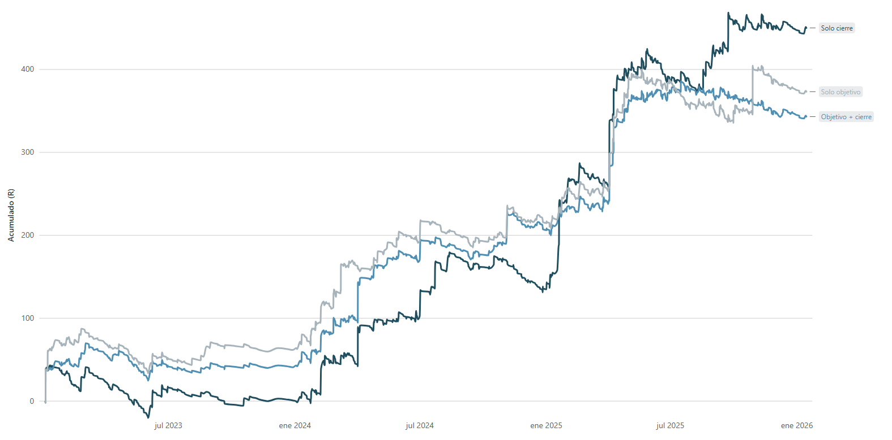
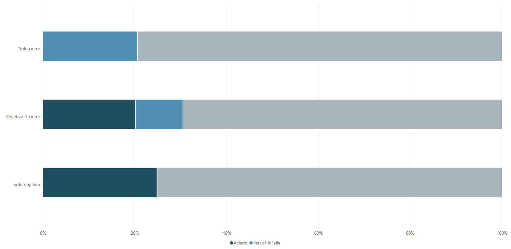
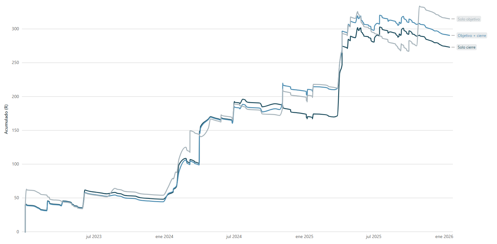

<!-- ===== BANNER ===== -->

# **Sistema de Inversión por Barridos de Liquidez**

### <samp>Caso de estudio de análisis de datos · Barridos de liquidez en mercados de divisas</samp>

 

**Elliot Herrera Principe** · **Data Analyst**

 

<!-- ===== STACK BADGES ===== -->

 

## Sobre este proyecto

> Un sistema de inversión basado en **barridos de liquidez** (liquidity sweeps):
> momentos en que el precio rompe niveles clave, activando
> órdenes limit antes de revertir.

**La pregunta de análisis:**

> _Después de un barrido de liquidez, ¿la reversión genera un valor
> esperado consistente, medido en R (Renta / Riesgo)?_

|       Periodo       |    Operaciones     |    Pares     |    Sesiones    | Tipos de barrido |
| :-----------------: | :----------------: | :----------: | :------------: | :--------------: |
| Ene 2023 → Ene 2026 | **1.029** barridos | **7** majors | **4** sesiones |   **4** tipos    |

 

_EURUSD · AUDUSD · GBPUSD · USDJPY · NZDUSD · USDCAD · USDCHF_

_Gestión de toma de ganancias con R fijo (0.5R → 25R) y R estratégico. Incluye costos por operación (fee + spread + swap)_

 

## Hallazgos

### La gestión importa más que la entrada

Cuanto más se deja correr una operación y se toman ganancias con un ratio
mayor a **3R**, mayor beneficio acumulado en el tiempo.

| Objetivo | Resultado                                              |
| :------- | :----------------------------------------------------- |
| **< 3R** | Tasa de acierto alta, pero **ganancia real negativa**  |
| **≥ 3R** | Menos aciertos, pero **beneficio acumulado creciente** |

> _Mucha precisión no paga cuando la ganancia por acierto es pequeña
> frente al riesgo._

### El edge se concentra en pocos trades

Las mayores ganancias se concentran en un grupo pequeño de operaciones
con **potencial de entrada ≥ 10R**. La distribución de resultados es de
colas (fat tail): pocas operaciones de gran magnitud generan casi todo el
rendimiento acumulado.

### Sesgo de supervivencia

> La recopilación de datos pasó por **muchos filtros sucesivos** hasta
> que el sistema quedó "recolectado": los datos fueron **cocinados**
> a medida que el sistema se ajustaba, y lo que quedó es el clásico
> _sistema superviviente_. **Esta información está sesgada.**

### Validación real

El sistema se empezó a probar y ajustar durante **2024 y 2025**. Cuando
se intentó replicar el mismo sistema con las mismas reglas sobre los
datos de **2023**, el edge **no se nota realmente**.

### Lección

> A pesar de que las métricas se ven bien, **no hay un edge real** — al
> menos no en la forma medida como sistema rígido.
>
> La lección como analista: no basta con que "pinte bonito"; hay que
> entender el **porqué** de los filtros y separar el sesgo de la promesa.

 

## Dashboard

Visualizaciones construidas en **Power BI** sobre las 1.029 operaciones registradas.
Dos formas de salir de la operación: **objetivo fijo** y **objetivo estratégico**.

### Salida por objetivo fijo

**R acumulado en el tiempo, por objetivo**

Cada línea es el R acumulado si se hubieran tomado ganancias a un
objetivo fijo (0.5R a 25R).

- **A mayor R, mayor ganancia en el tiempo:** los objetivos altos
  (15R–25R) dominan de forma consistente el rendimiento acumulado;
  los objetivos bajos (0.5R–3R) se van a terreno negativo.
- **Hito 2023 → 2024:** durante **2023 no existe un edge significativo**
  — todas las curvas rondan el cero o caen. Lo que se "cocinó"
  (se probó y ajustó) durante **2024–2025** es lo que se validó hacia
  atrás sobre 2023: el edge aparece solo en el período caliente.

**Tasa de acierto por objetivo**

- **A menor R, mayor acierto:** con objetivo de 0.5R - 1R más de la
  mitad de las operaciones llega a TP.
- **Pero correlacionado con el gráfico anterior:** tanto acierto en
  pocos R **no se traduce en ganancia acumulada** — la tasa de acierto
  engaña; lo que paga es el tamaño del objetivo.

### Objetivo estratégico: objetivo vs cierre

**R acumulado en el tiempo, por estrategia de salida**

Comparación de tres formas de cerrar la operación: dejar correr hasta
el cierre por intervencion de noticias de alto impacto o por cierre de sesion semanal (**Solo cierre**), salir solo cuando el precio alcanza el objetivo (riesgoso por exposicion a gaps)
(**Solo objetivo**) o combinar ambos y cerrar cuando alguna se cumpla antes (**Objetivo + cierre**). Cabe destacar que en todos los casos se respeta un limite de perdida (stop loss).

- **"Solo cierre" es la estrategia ganadora:** dejar correr la
  operación captura las colas de la distribución (esas que generan
  casi todo el rendimiento).
- Desde **2023** las tres estrategias ya acumulan R positivo — pero la
  separación real ocurre después del ajuste del sistema en 2024–2025.

**Tasa de acierto por estrategia de salida**

- **"Solo objetivo" tiene el acierto más alto** — y aun así es
  la estrategia más modesta en R acumulado.
- **"Solo cierre" acierta menos** y aun así gana **un poco más** que
  las demás: vuelve a ganar las colas de la distribución, no la
  precisión.

### El filtro que importa: potencial de entrada alto

**Estrategias de salida, filtradas solo a operaciones con potencial ≥ 10R**

Aquí la imagen es descarnada: al filtrar solo las operaciones con
**potencial de entrada ≥ 10R**,

> el edge existe desde **2023** — las tres estrategias acumulan R
> consistentes desde el inicio del registro.

- El rendimiento no lo define la estrategia de salida sola: lo
  define **dónde hay potencial grande** para recorrerlo.
- Confirma los hallazgos: el rendimiento se concentra en pocas
  operaciones de colas, y saber _dónde_ ocurre vale más que la
  pericia de gestión.

 

<!-- ===== CONTACTO ===== -->

 

### Hablemos

&nbsp;

&nbsp;

