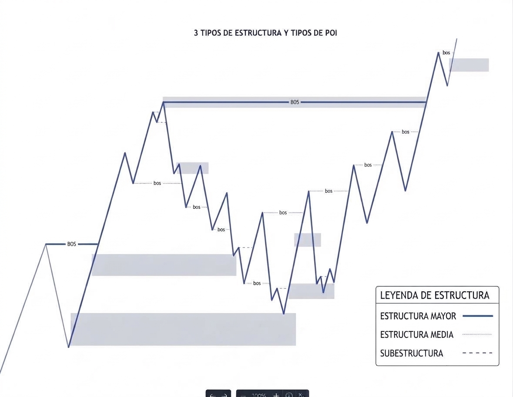
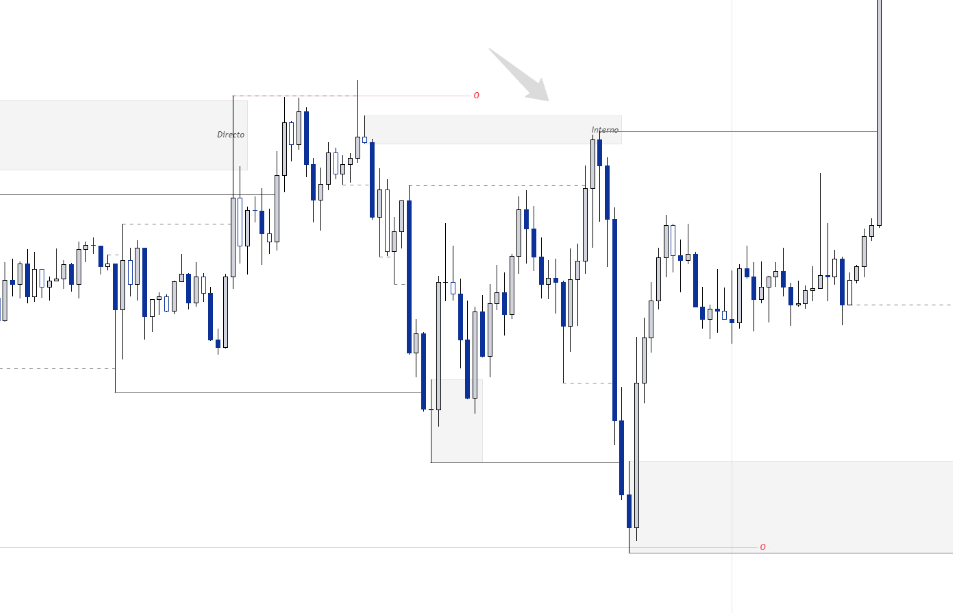
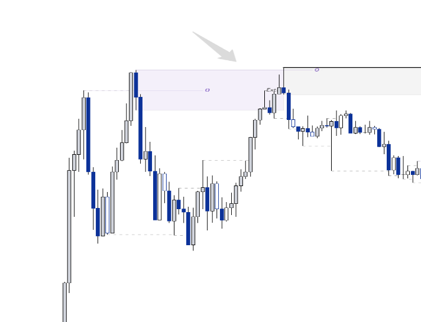
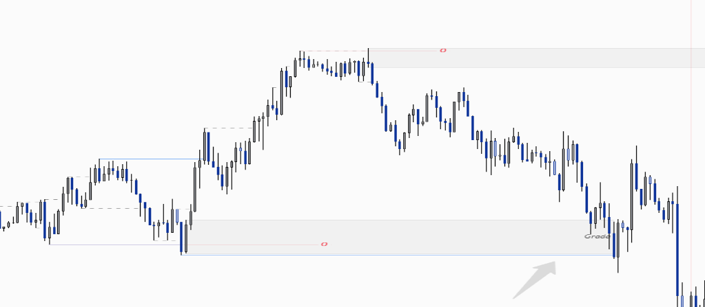
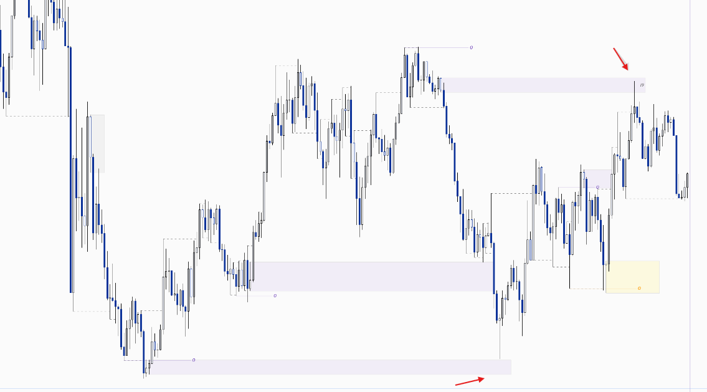

# Reglas de entrada: marco general

> Contexto metodológico del proyecto de análisis de datos de entradas del sistema de inversión.
> Este documento describe cómo se generaban las entradas para dar sentido a las variables del dataset. No es una recomendación de inversión.

---

## 1. Alcance

- **Temporalidad:** gráficos de 15 minutos.
- **Activos:** pares _major_ de divisas (mayor liquidez). El método solo se ha probado en estos pares.
- **Pregunta central del análisis:** la entrada y el stop son mecánicos, definidos por las reglas. Lo que se estudia es **hasta dónde conviene dejar correr cada operación (take profit)**.

---

## 2. Estructura de precio (3 niveles)

| Nivel                | Definición                                                       | Vigencia                                                                                 | Uso                                                                                                                   |
| -------------------- | ---------------------------------------------------------------- | ---------------------------------------------------------------------------------------- | --------------------------------------------------------------------------------------------------------------------- |
| **Estructura mayor** | Estructura principal del gráfico. Solo puede haber una vigente.  | Una nueva estructura mayor elimina la anterior y se ignoran sus datos.                   | Su máximo y mínimo son zonas clave. Que el precio los barra (_liquidity sweep_) es la primera señal para una entrada. |
| **Estructura media** | Requiere al menos 16 barras (4 h). Se generan de forma continua. | Sus hitos (altos y bajos) se conservan mientras no se active una nueva estructura mayor. | Todos los altos y bajos dentro del rango de la estructura mayor sirven para validar barridos.                         |
| **Subestructura**    | La más rápida; puede cambiar de dirección cada 15 minutos.       | Solo importa el último hito; el resto se ignora.                                         | Si el último alto o bajo es superado mediante un barrido, queda como requisito previo para la ejecución.              |

_Los tres niveles de estructura (mayor, media y subestructura) y los POI que generan sus rupturas (BOS)._

### Criterio de activación de una nueva estructura mayor

Se crea una nueva estructura mayor cuando el precio supera un máximo o mínimo anterior **con cuerpo de vela** (cierre, no solo mecha) y se cumple una de estas condiciones:

| Caso                           | Condición adicional                                |
| ------------------------------ | -------------------------------------------------- |
| Continuación (misma dirección) | Al menos **96 velas** (equivale a 24 h en 15 min). |
| Cambio de dirección            | Ninguna; no importa la cantidad de velas.          |

Al activarse, la estructura mayor anterior se descarta.

## 3. Secuencia de entrada

1. **Barrido de liquidez** en un hito relevante (máximo/mínimo de la estructura mayor, o altos y bajos de la estructura media, o alto y bajo de la ultima subestructura). Es la primera señal.
2. **Cambio de dirección**, al menos en sentido subestructural, después del barrido.
3. **Gap limpio**: existe un gap totalmente limpio, que no ha sido mitigado (_fair value gap_).
4. **Inside bar**: la vela siguiente a la que rompe la zona de liquidez no supera el alto ni el bajo de la vela anterior. Se admiten cuatro variantes del patrón (interno, extendido, grada e interno 3-9), detalladas en la sección 4.
5. Con las condiciones cumplidas, la zona queda confirmada como **zona de decisión** y se programa el trade.

---

## 4. Patrones de confirmación del barrido

La confirmación se hace con una **inside bar** (vela de rango interno): la vela posterior al barrido no supera el alto ni el bajo de la vela anterior. Para absorber las diferencias de pintado entre brokers (spread, _feed_ de precios y horario de la vela), el sistema admite cuatro variantes:

| Patrón          | Definición                                                                                                               | Tolerancia sobre el rango de la vela anterior           |
| --------------- | ------------------------------------------------------------------------------------------------------------------------ | ------------------------------------------------------- |
| **Interno**     | _Inside bar_ estricta: la vela siguiente queda completamente dentro del rango de la anterior.                            | 0%                                                      |
| **Extendido**   | _Inside bar_ en la que se permite que la vela supere **uno** de los límites de la vela anterior.                         | Hasta un **10%**                                        |
| **Grada**       | _Inside bar_ en la que se permite que la vela supere **ambos** límites de la vela anterior, formando un pequeño escalón. | Hasta un **10%** en cada límite                         |
| **Interno 3-9** | Después de la vela de barrido, se admite una _inside bar_ **con gap** que aparezca dentro de las **9 velas siguientes**. | Según el patrón que cumpla (interno, extendido o grada) |

> La tolerancia del 10% no cambia la lógica de la entrada: existe para que una misma zona no se descarte por milímetros de diferencia entre brokers. Sin ella, el conteo de patrones quedaría sesgado por la plataforma usada para recopilar los datos.

### 4.1 Interno

La vela de confirmación no supera ninguno de los dos límites de la vela de referencia. Es el patrón más restrictivo y, por tanto, el de menor tolerancia al ruido entre brokers.

### 4.2 Extendido

La vela de confirmación puede sobrepasar **uno** de los límites de la vela anterior hasta un 10% de su rango. La estructura sigue siendo válida aunque el broker pinte una mecha algo más larga de un lado.

### 4.3 Grada

La vela de confirmación puede sobrepasar **ambos** límites de la vela anterior hasta un 10% de su rango en cada lado, dibujando un pequeño escalón. Cubre el caso en que el rango de la vela queda desplazado respecto al de la referencia por diferencias de _feed_.

### 4.4 Interno 3-9

Después de la vela de barrido, dentro de las **9 velas siguientes**, si aparece una _inside bar_ **con gap** se puede tomar igual como confirmación. Esto permite no perder la zona cuando la reacción tarda algunas velas en formarse.

**Distribución en el dataset (1.029 operaciones):** Interno 562 · Interno 3-9 226 · Extendido 173 · Grada 68.

---

## 5. Protección de entrada y stop loss

Cada zona confirmada lleva una **protección** (_buffer_) tanto en la entrada como en el stop loss. La orden no se coloca exactamente en el borde de la zona, ni el stop exactamente en el hito barrido: ambos se desplazan unos pips para evitar que el spread, el ruido entre brokers o un falso toque saquen la operación antes de tiempo.

| Concepto                    | Qué hace                                                                                                     | Dónde queda registrado                                                           |
| --------------------------- | ------------------------------------------------------------------------------------------------------------ | -------------------------------------------------------------------------------- |
| **Protección de entrada**   | Desplaza la entrada respecto al borde de la zona para asegurar que el precio la atraviesa de forma efectiva. | `proteccion_entrada` en la hoja `sub-datos` (por par) → columna `E+1s` en `Data` |
| **Protección de stop loss** | Amplía el stop más allá del hito barrido para no ser barrido por el spread o por el pintado de otro broker.  | `proteccion_sl` en la hoja `sub-datos` (por par) → columna `SL+xs` en `Data`     |

La protección se define **por par**, porque cada uno tiene spread y volatilidad distintos (por ejemplo, 0.2 pips en EURUSD, AUDUSD y GBPUSD frente a 0.5 en USDJPY). Estas columnas forman parte del cálculo de R y, por tanto, **se incorporan al análisis en Power BI y Excel**: los resultados no se miden sobre precios teóricos, sino sobre la entrada y el stop efectivamente protegidos.

---

## 6. Vigencia de la zona de decisión

La zona es válida hasta que ocurra una de estas dos cosas:

- Se activa y la operación se cierra en ganancia o en pérdida.
- El precio genera nuevos movimientos mayores que la dejan obsoleta.

---

## 7. Relación con el dataset

Las columnas citadas corresponden a `sistema_de_barridos.xlsm` (hojas `Data` y `sub-datos`).

| Columna del dataset        | Regla o paso que mide               | Descripción                                                                                               |
| -------------------------- | ----------------------------------- | --------------------------------------------------------------------------------------------------------- |
| `T. Barrido`               | Patrón de confirmación (sección 4)  | `Interno`, `Extendido`, `Grada` o `Interno 3 - 9`.                                                        |
| `Posición`                 | Dirección de la operación           | `Compra` o `Venta`.                                                                                       |
| `Pot.` / `Pot. R`          | Potencial de la operación           | `Pot.`: recorrido disponible en pips. `Pot. R`: tramo en R (p. ej. `6R+`, `10R+`). Base del filtro ≥ 10R. |
| `E+1s`                     | Protección de entrada (sección 5)   | Entrada ajustada con la protección del par.                                                               |
| `SL+xs`                    | Protección de stop loss (sección 5) | Stop ajustado con la protección del par.                                                                  |
| `2R`…`100R`, `A`, `B`, `C` | Resultado según take profit         | R obtenido con cada objetivo fijo o estratégico, ya con costos.                                           |
